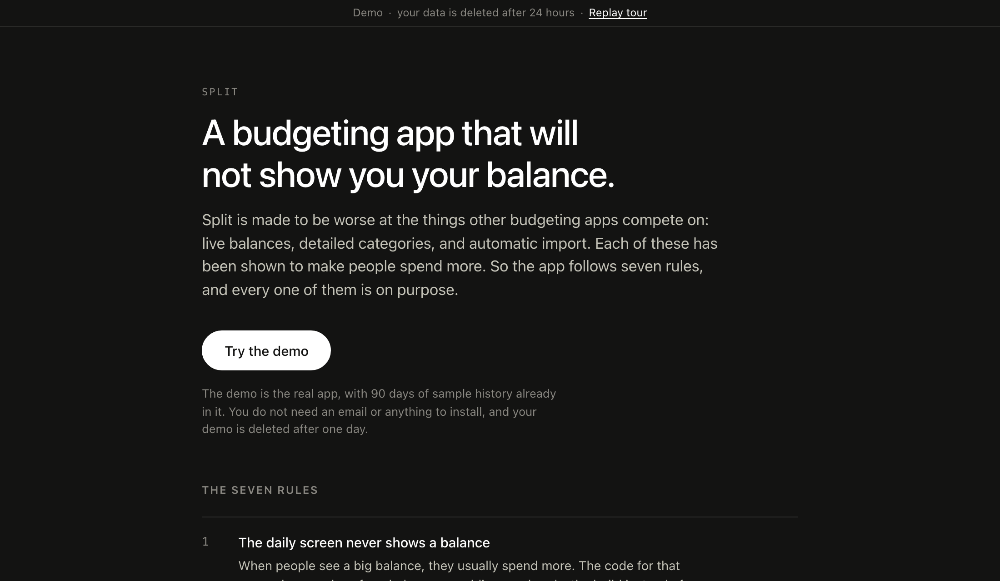
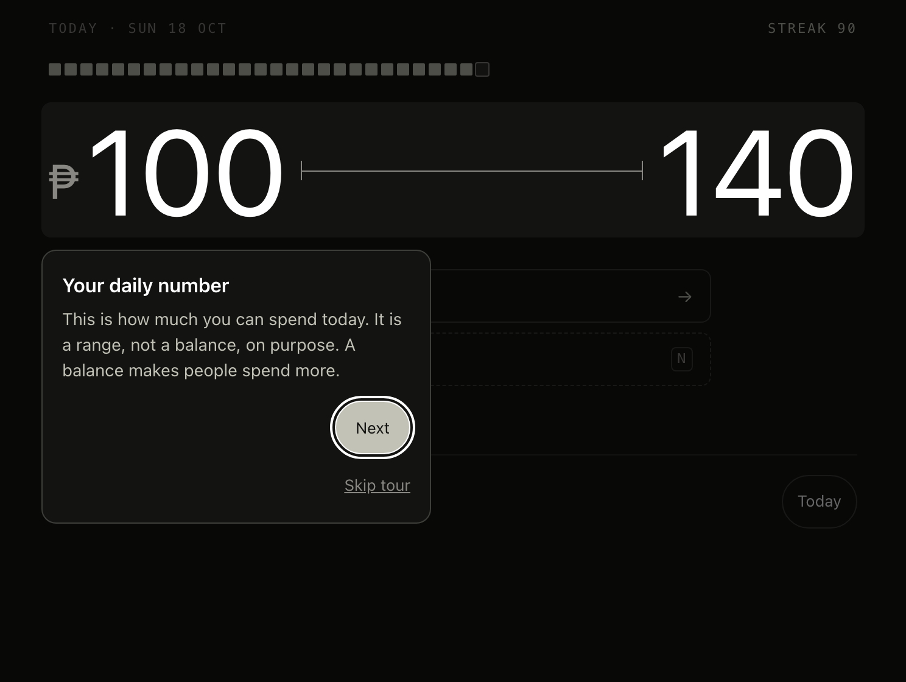
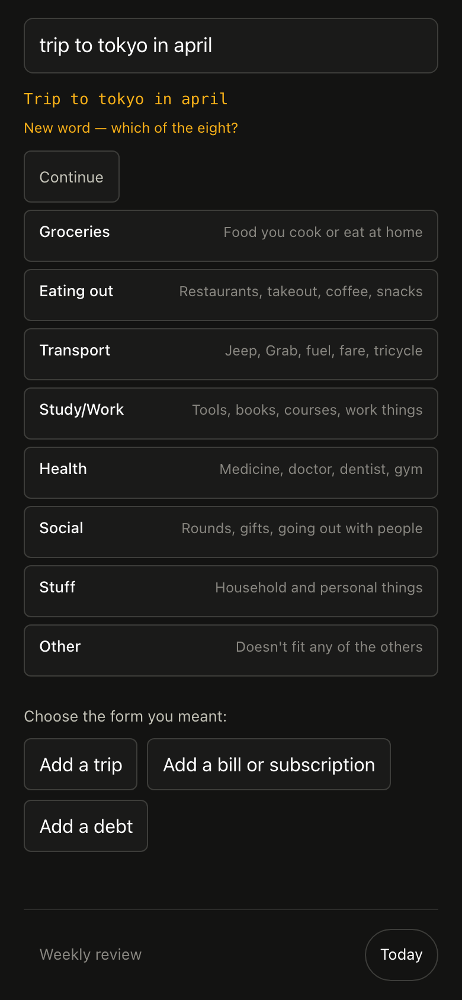

# Split

**A budgeting app that refuses to show you your balance.**

**Live demo: [split.jlndev.xyz](https://split.jlndev.xyz)** · no sign-up · a short guided tour shows you around

<p align="center"></p>

Every other budgeting app competes on live balances, automatic bank import and
rich category breakdowns. Split ships none of them, on purpose, because the
field evidence says each one measurably makes people spend _more_. What it shows
instead is a single band — _spend roughly ₱450–570 today_ — and a box to type
what you just bought.

```
                    ₱450 – ₱570
                       today

              ┌──────────────────────┐
              │  kape 65             │
              └──────────────────────┘
```

That is the entire daily screen. No balance, no total, no progress bar, no
"₱412 remaining". The absence is the product.

Typing in each purchase yourself is the mechanism, not a missing feature. Every
other app in this category competes on removing that step with bank import and
automatic categorisation. The research says that step is the part that works,
so Split keeps it.

## Try the demo

1. Open **https://split.jlndev.xyz** and click **Try the demo**.
2. You get your own private account with 90 days of sample history already in it.
   Nobody else can see it, and it is deleted after 24 hours.
3. A six-step tour shows you the daily range, how to log a purchase, the AI step
   and the weekly review. You can skip it, or replay it from the banner at the top.

Things to try once you are in:

- Type `jollibee 245`, then answer the quick question to save it.
- Type `trip to tokyo in april` and tap **Continue**. Laya, a small AI model
  running on the server, suggests which form you meant.
- Open **Weekly review** to see the week as a whole.

| The guided tour | Laya's suggestion (phone) |
|---|---|
|  |  |

**What the demo leaves out.** To keep it short, the demo shows only Today and
Weekly review. The other screens (accounts, big bills, subscriptions, trips,
debt, wishlist, trends, settings) are in the full app and described under
[The screens](#the-screens).

**How the demo is kept apart from real data.**

- It runs in its own Docker container, published only on the host's localhost
  and reached through a Cloudflare Tunnel. Nothing from the host is mounted into it.
- In demo mode the server refuses to start unless its database is empty or
  marked as a demo database (`scripts/demo-guard.js`). The check runs before any
  migration, so a wrong `DATABASE_URL` cannot open a real budget.
- New demo accounts are limited to 5 per IP per hour and 200 at a time, and
  expired ones are deleted every hour.
- It runs on the author's Mac, so it is down whenever the Mac sleeps.

## Laya: the one AI step

When the text you type is not a purchase, you tap **Continue** and a small
zero-shot model ([`@receptron/laya`](https://www.npmjs.com/package/@receptron/laya),
pinned revision, run locally in `laya-service/`) suggests which form you meant.
It only sees the typed text and the names of the actions, never budget data.
If it is down or slower than 1.5 seconds, you get plain choices instead.

It was measured before it was trusted, on 234 labelled entries (92 in Taglish):

| | Result |
|---|---|
| Right action decided or offered as a choice | 170 / 234 (73%) |
| Right action decided outright | 144 / 234 (62%) |
| The model alone, on the entries the parser could not decide | 65 / 142 (46%) |
| Forms that open on their own | only "Add a trip": 11 of 11 correct |

Because the model's confidence turned out to be unreliable, every other answer
stays a ranked choice, and nothing is saved until you submit the form. These
numbers come from the set used to tune the settings, not a held-out test, and
the full write-up is in [`eval/laya/results-2026-10-18.md`](eval/laya/results-2026-10-18.md).

---

## Why it exists

I built this because the budgeting apps I used were making me worse with money,
not better. Each one ended the same way. I had a clean, well-categorised record
of my overspending, I checked it almost every day, and I never did anything
about it.

It turns out there is research on this, and it does not look good for the
category. Pocheptsova Ghosh and Huang ran three field studies and two lab
experiments on budget-tracking apps. People who tracked their spending from
memory stayed inside their budgets. People who regularly checked an app
**went over theirs by around a quarter to a third**, and the overspending
happened mostly near the end of the budget period.

The reason is the precision itself. When you only have a rough sense of where
you are, you leave yourself a margin without thinking about it. When the screen
says "₱412 left", that margin is gone. The number stops being information and
becomes a target you are allowed to reach, and then a little past it.

So Split does the opposite. It keeps the exact number from you. One band, one
account, one minute of logging at night. The money is moved out of reach before
you decide anything, instead of being measured after you already spent it.

None of this is my personal opinion about budgeting. Every constraint in the app
points back to a numbered finding (**F1**–**F14**) in
[`split-combined-spec.md`](split-combined-spec.md). If you think a rule is
wrong, the argument is with the study under it.

## The paper it's built on

If you only read one citation from this project, read this one:

> **Soman, D. (2001). "Effects of Payment Mechanism on Spending Behavior: The
> Role of Rehearsal and Immediacy of Payments."** _Journal of Consumer Research_
> 27(4), 460–474. [doi:10.1086/319621](https://doi.org/10.1086/319621) ·
> [full text](https://www-2.rotman.utoronto.ca/facbios/file/paymechjcr.pdf) ·
> 466 citations

Soman changed only one thing, the _payment mechanism_, and then measured what
people did on the next purchase. A past payment held back the next one **only
when the mechanism made the person write the amount down**. He calls this
_rehearsal_. It also had to be money that left immediately, not later. In his
first experiment, 160 students went through the same simulated month of
expenses. The ones who paid by check, so they had to copy each amount by hand,
later rated their likelihood of buying an extra item at 3.80, while the ones who
paid the same amounts by credit card rated it 5.26 (F(1, 152) = 18.23, p <
.001). Same money, same month. The only difference was whether they wrote the
numbers down.

This is why the app has no bank sync and will not get one. The typing is not
extra work attached to the real intervention. The typing **is** the
intervention. An automatic feed pulls in the transaction and quietly removes the
one moment where you notice what you are doing, which is the only moment that
does anything. A budgeting app with bank sync is the more impressive product and
the weaker one. That trade is the whole point of this repository.

Together with it, for the rule against per-category budgets:

> **Heath, C. & Soll, J. B. (1996). "Mental Budgeting and Consumer Decisions."**
> _Journal of Consumer Research_ 23(1), 40–52.
> [doi:10.1086/209465](https://doi.org/10.1086/209465) · 764 citations

People really do set budgets per category in their heads, and they really do
track against them. The problem is that a budget cannot predict which
opportunities will actually come up, so the category itself causes two
failures: spending too much, and the quieter one, refusing something that was
worth it because the wrong envelope was empty. Splitting a spending budget into
categories also gives you an accounting excuse for almost any purchase. This is
why the eight categories here are only for the weekly review and carry no
budgets at all.

The rest of the evidence is in [Part One of the spec](split-combined-spec.md),
with a forty-entry reference list at the end: the Drexler, Fischer and Schoar
rule-of-thumb RCT, Madrian and Shea on defaults, the Ashraf, Karlan and Yin
commitment-savings experiment here in the Philippines, Soman and Cheema on
partitioning, and the Harkin et al. meta-analysis on monitoring.

**One honest caveat, because a reviewer would find it anyway.** The
_range-instead-of-a-number_ rule rests on Pocheptsova Ghosh and Huang, and that
is a Think Forward Initiative and CEPR working paper, not a peer-reviewed
article. Heath and Soll covers the no-categories half on its own. The band
itself is a design bet on one unrefereed source. The spec says so in the same
words.

## The seven rules

| #   | The rule                                           | Why it is not an oversight                                                                                                                                           |
| --- | -------------------------------------------------- | -------------------------------------------------------------------------------------------------------------------------------------------------------------------- |
| 1   | The daily screen never shows a balance             | Seeing a large balance reliably makes people spend more. `todayView()` has no field for one, so adding it is a compile error rather than a code-review conversation. |
| 2   | The daily number is a range, not a number          | "₱103 left" reads as permission to spend ₱103, then a little past it. A range has no edge to spend up to.                                                            |
| 3   | You type every purchase yourself                   | No bank, card or e-wallet sync, ever. The typing is the mechanism (Soman 2001); automatic tracking removes the one moment where you notice.                          |
| 4   | Eight category roots, and no budget on any of them | Subdividing a spending budget is the one intervention that measurably backfired. Categories exist for the weekly review and nothing else.                            |
| 5   | Underspending does not raise tomorrow's number     | Set once when the week opens and frozen. `dailyAllowance()` takes no `daysRemaining` parameter, and that absence is the point.                                       |
| 6   | A 15% cushion comes off the top, hidden            | People cannot hold a mental buffer, so the app holds it structurally and sweeps it to savings at the close.                                                          |
| 7   | Bills never touch your spending money              | Commitments are reserved before the daily figure is computed. A cost you cannot decline has no business competing with a coffee.                                     |

Rule 4 was relaxed once, deliberately and on the record: categories may now
_grow_, as leaves under the eight fixed roots, because the finding it rests on
prohibits attaching **budgets** to categories — which stays absolute — not
having more labels. The reasoning is in the design notes.

## Who this is for

**This will probably work for you if** you have already tried a few budgeting
apps and stopped using all of them. If your real problem is the small day-to-day
spending and not that you do not know your income. If you can give it one minute
at night and about fifteen minutes once a week. And especially if you are the
kind of person who checks a balance, sees that there is still room, and treats
that room as permission. That last one is the exact habit this app was built
against, and it is the one I have.

**This will not work for you if** you want your spending tracked without you
doing anything. The participation is the active ingredient here. Take it out and
there is nothing left. It is also the wrong tool for couples or any shared
budget, because it is single-user by design, and the wrong tool for business
accounting or for anyone who needs a live balance for an actual operational
reason. And if you are someone who genuinely budgets well by category, then
based on Heath and Soll you are the exception, and you should keep doing what
already works for you.

## Features

- **The band.** One range per day, computed once at period open from the
  allocation and then frozen — `spend_alloc ÷ days × (1 − haircut)`. It does not
  go up because you were good yesterday.
- **Sixty-second logging.** Amount → category → planned/unplanned → save. Typed
  entry parses `kape 65` into a transaction and `wifi bill 750` into a
  commitment, and refuses to guess when the record _type_ is ambiguous.
- **The weekly money date.** Six resumable steps, about fifteen minutes, ending
  in a snapshot and one shareable line: `Week 32: spent ₱3,585 · unplanned 68% ·
buffer 3.1 weeks · streak 11`.
- **The irregulars engine.** An event-by-event list of exceptional costs rather
  than a monthly average, every estimate padded 25%, accrued before the cost
  lands, with forced three-way reconciliation and no dismiss button.
- **The Money Map.** Five accounts, the split drawn once, a transfer checklist,
  and every open IOU listed individually — never summarised into a count.
- **Trip Mode.** The hero inverts on a trip: a precise figure, in local currency,
  divided by days _remaining_. Local amount is the source of truth; the home
  figure is derived at the locked effective rate. None of it touches your
  metrics.
- **The debt price switch.** Avalanche, snowball and hybrid costs side by side,
  with the recommendation marked and the price of choosing motivation shown.
- **The phase engine.** Five phases with machine-checkable exits. It proposes and
  never advances on its own, because a phase change moves real money.
- **Streaks that count logged days, not spending days.** A zero-spend night filed
  as "nothing to log" is a full day of streak.
- **Self-hosted, one container, one file.** SQLite in WAL mode, real reviewable
  SQL migrations, a nightly backup whose restore path is exercised by the test
  suite rather than only in an emergency.

## For reviewers: what's worth looking at

If you are reading this to assess the engineering rather than to use the app,
the four things I would point at are the **type-level withholding guard**
(`src/lib/server/withholding.ts` — the product's central rule enforced by the
compiler, and the guard type-tests itself so a refactor that neuters it fails the
build), the **tenancy choke point** (`forUser(userId)`, with the unscoped handle
never exported and a two-tenant leak test gating every public step), the **shared
txn selector** that carries `AND trip_id IS NULL` so no individual metric has to
remember it, and `src/lib/allowance.ts`, where two nearly-identical functions sit
side by side with comments explaining why unifying them is the bug.

> **A note on names.** The spec ([`split-combined-spec.md`](split-combined-spec.md))
> and some older documents call the app _Longhand_, its working name. The product
> is Split, and the code has always used `split`.

## The parts worth reading

**Tenancy is enforced by making the mistake impossible, not by care.** The
unscoped database handle is never exported from `src/lib/server/db/index.ts`;
every query goes through `forUser(userId)`. Three layers back it up: `user_id
NOT NULL` on all twenty tables, a test that enumerates the live schema and fails
any table that lacks it, and a two-tenant leak test that drives every read path
as one user and asserts zero rows of the other come back. That last one gates
every public step.

**The withholding layer is a type, not a convention.** `todayView()`'s return
type has no balance field, so the rule that makes this app what it is cannot be
broken by accident.

**Typed entry guesses the category freely and never guesses the record type.**
`kape 65` is a transaction; `wifi bill 750` is a commitment that is already
reserved and must not be logged again. A wrong category costs one line in a
review; a wrong record type counts the wifi twice and corrupts the daily figure
for the rest of the period. Ambiguity resolves to a question, never a default.

**Offline logging is one-way replay, not sync.** `txn.client_uuid` is UNIQUE and
the log action already treats a repeat as a double-submit, so replaying a queue
is safe by construction. Only the user's own device creates transactions, so
there is no merge and no conflict resolution.

**Money is integer minor units everywhere.** No floats, no `parseFloat` outside
`src/lib/money`.

**Migrations are real, reviewable SQL** with a prose header saying _why_, applied
once each inside a transaction, with `PRAGMA foreign_key_check` read afterwards
and an orphaned reference treated as fatal.

## Check the claims

```bash
npm test          # 744 tests: every rule above, the tenancy leak test, the demo guard
npm run check     # svelte-check, zero errors
```

Full design documentation: [`split-combined-spec.md`](split-combined-spec.md).
Read Part One before writing code — see [`CONTRIBUTING.md`](CONTRIBUTING.md) for
why.

## Run it

```bash
npm install
npm run db:migrate
npm run db:init -- --currency PHP --symbol ₱ --tz Asia/Manila --period weekly --take-home 6000
npm run dev
```

Sign in and answer the five questions at `/setup`.

`--alloc` is the Spend allocation for the whole period, in major units. The
daily number is derived from it once, at period open, and frozen:

```
daily_allowance = spend_alloc ÷ days × (1 − haircut)
₱4,200 ÷ 7 × 0.85 = ₱510/day, displayed as ₱450 – ₱570
```

The 15% haircut is the structural safety margin (F5). It is not hidden —
`--haircut` on `db:init` changes it, and the surplus is recorded as
`period.swept_minor` when the period closes.

`--take-home` is your weekly take-home pay, asserted once. Without it the buffer
weeks metric stays blank rather than guessing. Phase 3 replaces it with the
minimum of the last three months of real income — never the mean (Rule 1).

## The screens

**`/` — Today (DAILY class).** One band, one log form, today's entries. No
balance, no total, no remaining figure. It also carries the streak, the
review-due prompt, the single-day catch-up, one horizon line when an irregular
lands inside seven days, and a prompt when a transfer is two days overdue.
Nothing else may be added — see [`CONTRIBUTING.md`](CONTRIBUTING.md).

**`/irregulars` (REVIEW class).** Coverage leads the page, and below 1.0 it
takes the page over. Overdue instances sit above everything with a forced
three-way choice — paid, skipped, or rescheduled, no dismiss — because the
failure that kills this system is a ledger that quietly stops matching the bank
while the app reports healthy coverage.

**`/accounts` — the Money Map (REVIEW class).** Phase banner with the exit
arithmetic, the accounts table, the split drawn once, the transfer checklist,
and every open IOU listed one by one.

**`/trips` (REVIEW class).** Declare → fund → activate → settle. The funding
check fires 14 days out with three options and no dismiss.

**`/debt` (REVIEW class).** All three payoff costs side by side, with the
recommendation marked.

**`/rules` (REVIEW class).** 19 pre-seeded if-then plans and the 72-hour list.

**`/trends` (REVIEW class).** The five metrics as sparklines and small
multiples, plus a category heatmap.

**`/review` — the weekly money date (REVIEW class).** Six steps, resumable,
about fifteen minutes:

| Step | What it does                                                                |
| ---- | --------------------------------------------------------------------------- |
| R1   | Type the four balances, with last week's values as ghosts                   |
| R2   | This week's actuals by category, plus the unplanned ratio against last week |
| R3   | The top three transactions — "would I do that again?"                       |
| R4   | The week ahead, and what on it costs money                                  |
| R5   | Adjust the daily number, which supersedes the period rather than editing it |
| R6   | Snapshot the metrics and generate the line you send to one other human      |

R6 produces exactly this, and `shared_at` records that you sent it:

```
Week 32: spent ₱3,585 · unplanned 68% · buffer 3.1 weeks · streak 11
```

Today and the REVIEW screens look deliberately unlike each other: one number on
an empty field against a dense instrument panel. That contrast is the
withholding layer made visible (Spec §8.0b.1) — if you can't tell which mode
you're in without reading, the design has failed.

## The irregulars engine

Two biases stack here. People underestimate weekly spending by roughly 30%, and
worse, they exclude _exceptional_ costs entirely because each one feels like a
one-off while in aggregate they are perfectly predictable (F10). So the engine
holds an event-by-event list rather than a monthly average, pads every estimate
by 25%, and accrues the money before the cost lands.

- **Coverage** = the Irregulars balance ÷ everything due in the next 90 days.
  Below 1.0 is the leading indicator that Buffer is about to get raided, so the
  page names the specific instance that bounces first.
- **Accrual** is recomputed every period, so adding a large cost due in two
  months raises the next two periods instead of quietly under-funding.
- **Actual is stored separately from estimate.** The gap is your personal
  calibration on F10 and the only honest way to know whether 25% is enough for
  you — it draws the estimate-accuracy chart.
- **Reconciliation is forced.** Three choices, no dismiss.

## The IOU rule

Money leaving Irregulars, Buffer or Grow needs a one-line note: why, and when it
comes back. `POST /accounts?/transfer` returns 422 without one. This is not
validation theatre — it comes straight from the winning arm of the Drexler
trial, and the note is the entire mechanism. It turns an invisible leak into a
countable event you read back at the quarterly audit, which is also why the
Money Map lists IOUs one by one and never summarises them into a count.

## Trip Mode

> A trip is not a spending period. It is a funded irregular being drawn down.

Travel is the most likely thing to break this app in real use, so it gets the
most structure at exactly the moment it feels like the moment to relax.

- **The hero inverts.** On a trip it is a _precise_ figure in the local
  currency, and it divides by days _remaining_ — both the opposite of the home
  screen. `dailyAllowance()` and `tripDailyFigure()` live side by side in
  `src/lib/allowance.ts` with cross-referencing comments, because a future
  refactor will notice they are nearly identical and try to unify them. That
  refactor is the bug.
- **Local is the source of truth.** `amount_local_minor` is what you typed;
  the home figure is derived at the locked rate and frozen per row. Correcting
  the rate recomputes home and leaves local byte-identical.
- **The rate is the effective one you got**, including ATM and card fees — not
  mid-market. Those fees dwarf two weeks of rate drift, so a live rate would be
  _less_ accurate. There is no FX API and there never will be.
- **`local_minor_units` is per trip and never inherited.** JPY/KRW/VND have
  none. The keypad drops the decimal point entirely when it is 0, and an entry
  over ten times today's figure asks for confirmation.
- **Settling takes two numbers.** `envelope − logged` is the estimate error and
  tunes next year; `actual − logged` is the FX-and-fee error and tunes next
  trip's rate. Different failures, different fixes.
- **The day boundary follows your body.** While a trip is active, the log day is
  keyed in `trip_tz`. Because `log_day` is keyed on a date string, the 23- and
  25-hour transition days are ordinary rows.
- **None of it touches your metrics.** That is the quarantine, shipped in
  Phase 3 for exactly this moment.

## The debt price switch

Snowball is motivationally optimal, avalanche is mathematically optimal, and
the difference has a price. `/debt` computes it and shows all three costs —
avalanche, snowball, and the hybrid that banks one subgoal completion before
optimising — with the recommendation marked. Under one period of Spend, buy the
motivation. Over it, optimise. You are entitled to overrule that knowingly,
which is why the numbers are always visible.

## The phase engine

Five phases, each with a machine-checkable exit. The engine **proposes**; it
never advances on its own, because a phase change moves your money and doing
that silently is unacceptable however right the arithmetic is. Every proposal
shows its working.

Two of the five exits cannot be evaluated yet and say so by name rather than
returning a plausible-looking "not yet": Phase 2 needs APRs per debt (Phase 4),
Phase 3 needs itemised Bills. Downgrades are ordinary events and the copy does
not treat them as failure — the recovery instinct after a setback is itself the
documented failure mode.

## Streaks, and why they are gameable

The streak counts _logged days_, not spending days. A zero-spend night filed as
"nothing to log tonight" is a full day of streak. That is intended: the streak's
job is to keep the app open nightly, and Spec §11 says a metric that cannot be
gamed is not measuring adherence. Do not "fix" it.

One missed day does not break the streak if you file the combined catch-up the
next day — the button appears on Today. Two consecutive misses break it, and
there is no backfill flow, because building the backfill flow is building the
guilt.

## Background jobs

`src/hooks.server.ts` starts an in-process scheduler: rollover at 02:00,
irregulars materialisation and the phase check at 02:15, backup at 03:00, in
your configured timezone. All are idempotent and keyed by the local date in
`job_run`, so a double tick is a no-op and a tick missed while the machine was
off is caught up on the next boot. Set `SPLIT_DISABLE_JOBS=1` to turn it off.

Nudges are deliberately not here. Spec §8.7 prefers a calendar reminder you set
yourself: more reliable across platforms, zero infrastructure, and it still
fires when the server is down.

## Backup and restore

```bash
npm run backup                                    # VACUUM INTO, then prune
npm run restore -- --list
npm run restore -- --latest                       # stop the server first
```

An untested backup is not a backup (Spec §12), so the restore path is exercised
by the test suite, not only in an emergency. Restoring keeps the previous file
at `<db>.pre-restore` — you are most likely to be panicking at exactly that
moment, and destroying the damaged original destroys the evidence.

## What's here

| Path                               | What it is                                                                                            |
| ---------------------------------- | ----------------------------------------------------------------------------------------------------- |
| `migrations/*.sql`                 | Real, readable SQL, one file per phase. No silent schema push.                                        |
| `scripts/migrate.js`               | Applies migrations once each, one transaction apiece                                                  |
| `scripts/init.js`                  | Writes the single `settings` row                                                                      |
| `/setup`                           | Opens (or supersedes) a period, in the browser                                                        |
| `scripts/backup.js` · `restore.js` | The manual handles for the nightly job                                                                |
| `src/lib/money.ts`                 | Integer minor units. The only place money is parsed.                                                  |
| `src/lib/allowance.ts`             | `dailyAllowance()` and `displayBand()` — shared, so the R5 preview cannot drift from what gets frozen |
| `src/lib/server/withholding.ts`    | The type-level guard behind Spec §4.2                                                                 |
| `src/lib/server/today.ts`          | `todayContext()` — the DAILY-class payload                                                            |
| `src/lib/server/week.ts`           | Review weeks, anchored on your week start, not ISO-8601                                               |
| `src/lib/server/streak.ts`         | Streak, longest run, and the 48-hour catch-up                                                         |
| `src/lib/server/metrics.ts`        | **The one txn selector every metric composes from**                                                   |
| `src/lib/server/review.ts`         | The artefact: rows, steps, snapshot, one-liner                                                        |
| `src/lib/server/rollover.ts`       | Close, sweep, open next, supersede                                                                    |
| `src/lib/server/jobs.ts`           | In-process cron, idempotent and date-keyed                                                            |
| `src/lib/server/irregulars.ts`     | Projection, materialisation, accrual, coverage, settle, reconcile                                     |
| `src/lib/server/accounts.ts`       | Accounts, goals, and the IOU rule                                                                     |
| `src/lib/server/phases.ts`         | The phase engine — proposes, never advances                                                           |
| `src/lib/server/allocations.ts`    | The transfer checklist                                                                                |
| `src/lib/components/Figure.svelte` | Every chart, with its table view and accessibility fallback                                           |
| `src/lib/server/trips.ts`          | Declare, fund, activate, rate, settle                                                                 |
| `src/lib/server/payoff.ts`         | Amortisation and the price switch                                                                     |
| `src/lib/server/rules.ts`          | If-then plans and the 72-hour list                                                                    |

## The withholding layer

The Today screen must never show an account balance, a category total, or a
precise remaining figure (Spec §4.2). That is enforced by the type system:

```
$ npm run check
ERROR src/lib/server/today.ts  Type '"spendBalanceMinor"' does not satisfy the constraint 'true'.
```

`src/lib/server/withholding.ts` also type-tests itself — if a refactor neuters
the guard, its `@ts-expect-error` proof becomes an error and the build fails.

## Not built yet

Two Phase 4 items are deliberately **not** built, and both are judgement calls
you should overrule if you disagree:

- **The PWA offline outbox** (Spec §8.7). The service worker and IndexedDB queue
  are real work whose payoff depends entirely on whether you actually log
  somewhere without signal. Spec §8.7 also says every statement about iOS PWA
  behaviour is stale on arrival and must be verified on your own device — so
  this is worth building _after_ you know you need it, against a phone you have
  tested.
- **The 7-day setup wizard** (Spec §8.5). Setup already happens in the browser,
  through the five questions at `/setup`.

### The one real gap

**Income sources are not built, and Spec §13 never assigns them to a phase.**
§4.1 and §6.1c describe `income_source`, `projectArrivals()` and the ordered
waterfall in full, but the roadmap goes Phase 1 "one manually-created period" →
Phase 3 "irregulars & phases" → Phase 4 "trips, debt, trends & polish". This
build followed the roadmap rather than quietly widening a phase. Two visible
consequences, both stated in the UI rather than hidden:

- Save rate stays `NULL` on the review snapshot.
- Rollover carries the allocation forward instead of projecting arrivals, and
  the transfer checklist knows only Spend and Irregulars — Bills, Buffer and
  Grow need the split.

That is the next decision to make, and it is yours.

Known deviations from the spec, all deliberate:

- **No note field on the log form.** The column exists. Keeping the entry to
  amount → category → flag → save protects the 60-second ritual (G1).
- **Delete is a button, not a swipe.** Same 44px target, keyboard-operable.
- **Planned/unplanned has no default.** Save stays disabled until it is chosen.
  A default would bias the unplanned ratio, which is the most diagnostic number
  you own (F10).
- **Review weeks are not ISO-8601.** They are anchored on
  `settings.week_starts_on`, because the money date is a Sunday and ISO weeks
  start on Monday. The label still reads `2026-W32`.
- **Rollover carries the allocation forward** rather than computing it. The real
  path needs `projectArrivals()` over real income sources, which is Phase 3.
  Inventing a figure by dividing an annual one is the bug Spec §12 says to treat
  as a defect on sight.
- **R4's calendar strip has no irregulars on it** — there is no irregulars
  engine yet. It takes a written note instead.
- **The review's bars and meters stay hand-rolled CSS.** Observable Plot draws
  the three Irregulars charts; meters, sparklines and the dot strip are ten
  lines each and a chart library makes them worse (Spec §8.6).
- **`txn.trip_id` has no foreign key.** SQLite accepts a forward reference at
  `ALTER` time and then fails _every_ insert into `txn` with "no such table:
  main.trip" — including rows where the column is NULL. Phase 4 adds the
  constraint when it creates the table.
- **The ~24 candidate irregulars are a picker, not seeded rows.** Appendix A
  says ship them pre-populated; 24 unchecked rows in the ledger would make
  coverage meaningless on day one. They still do the F10 work, because
  recognising a cost from a list is a different task from recalling it.

## Running it on a Mac — launchd (what is installed)

Same shape as the highcast agent already on this machine: `KeepAlive` so it
restarts if it dies, `RunAtLoad` so it is there after a login without anyone
starting anything.

```bash
npm run build
sh launchd/install.sh            # install and start
sh launchd/install.sh --remove   # stop and remove
```

It binds to `127.0.0.1:3000` and logs to `data/serve.log`. No sudo — a
LaunchAgent is per-user, which is the right scope for a loopback-bound
single-user app.

**After any code change, `npm run deploy`.** The agent runs the compiled
`build/`, not the source, so editing a file and restarting the agent serves the
old bundle with no error anywhere — the app just quietly stays as it was. That
script builds and restarts in the right order. `npm run logs` tails it.

**Prefer this over the container on a Mac**, for a reason that is not
convenience: the database sits on a native filesystem instead of a virtualised
bind mount, so WAL's cross-process shared memory works. `npm run backup`
against a running server succeeds here and fails intermittently under Docker
Desktop / OrbStack.

What launchd does **not** do is wake a sleeping Mac, so the 02:00 timers still
will not fire overnight. The 15-minute catch-up sweep in `jobs.ts` is what
closes that — every job is idempotent and keyed by the local date, so it runs
the moment the machine is awake again.

## Deployment — Tier A (Spec §9)

One container, one file, one private network. The whole disaster-recovery plan
is "copy `data/split.db` to the new box", and keeping that true is worth more
than any managed platform's convenience.

```bash
docker compose up -d
docker compose exec split node scripts/init.js \
  --currency PHP --symbol ₱ --tz Asia/Manila --period weekly --take-home 6000
```

Sign in and answer the five questions at `/setup`.

Migrations run at container start, so a container that is up is a container
whose schema is current. `GET /api/health` is the container health check and
returns nothing but `{"ok":true}`.

### The bind address, and what replaced it

**This changed.** Split used to have no login, so the bind address _was_ the
security control — invariant 10, and `scripts/serve.js` enforced it by refusing
to start on a public interface.

Going multi-user reversed that. Authorisation is now application code:
Google sign-in, a session cookie, and the `forUser(userId)` choke point that
makes an unscoped query impossible to write. The security that network
isolation gave for free is now something tests have to prove, which is why the
two-tenant leak test gates every public step.

The loopback default below still stands and is still the right thing for a
single-user install on your own machine. Nothing is reachable from outside
until you deliberately change it.

`docker-compose.yml` publishes to `127.0.0.1:3000` — out of the box nothing is
reachable from outside the machine, even on a host with a public IP. To reach
it from your phone, change the publish address to your Tailscale IP and set
`SPLIT_ORIGIN` to match:

```yaml
ports:
  - '100.x.y.z:3000:3000'
```

`scripts/serve.js` refuses to start on a **bare host** with `HOST=0.0.0.0`,
because there that means every interface including whatever the router
forwards. Inside a container the same value is correct — the container's
network namespace is private and the publish address governs reach — so the
check is conditional on where it is running, not on the string.

### Backups, and one real constraint

The nightly job backs up at 03:00 from inside the server process, and that path
is reliable. Catch-up runs on boot, so a machine that was off overnight backs
up when it comes back.

**A second process cannot always read the live database.** SQLite's WAL mode
needs shared memory to coordinate readers across processes, and shared memory
does not work over a virtualised bind mount — macOS → Linux under Docker,
network shares, some NAS setups. On those, `scripts/backup.js` fails
intermittently while the server is running. It detects this and tells you the
fix rather than dumping a stack trace:

```bash
docker compose stop
docker compose run --rm split node scripts/backup.js
docker compose start
```

Run it in a throwaway container rather than on the host — staying on one side
of the mount avoids a race between the host releasing the file and the server
reopening it, which I hit and which leaves the container exited with
`SQLITE_CANTOPEN`.

On a native Linux host — the actual Tier A target, a Pi or an old laptop —
this does not arise, because the data directory is an ordinary filesystem.

### What is deliberately not here

No reverse proxy, no TLS termination, no secrets manager, no orchestration.
Tailscale supplies the network and the TLS; everything else would be
infrastructure this app does not have a problem for (Spec §12,
over-engineering).

## References

The design is downstream of these. Full list, with the findings each one forces,
in [Part One of the spec](split-combined-spec.md).

- **Soman, D. (2001).** [Effects of Payment Mechanism on Spending Behavior: The Role of Rehearsal and Immediacy of Payments](https://academic.oup.com/jcr/article-abstract/27/4/460/1810425). _Journal of Consumer Research_ 27(4), 460–474. [doi:10.1086/319621](https://doi.org/10.1086/319621) — **the anchor paper.** Writing the amount down is what suppresses the next purchase. Rule 3.
- **Heath, C. & Soll, J. B. (1996).** [Mental Budgeting and Consumer Decisions](https://academic.oup.com/jcr/article-abstract/23/1/40/1892763). _JCR_ 23(1), 40–52. [doi:10.1086/209465](https://doi.org/10.1086/209465) — per-category budgets cause both over- and under-consumption. Rule 4.
- **Pocheptsova Ghosh, A. & Huang, L. (2022).** _Dynamic Budget Monitoring: When Access to Budget Feedback Leads to Increase in Spending._ Think Forward Initiative / CEPR technical report ([PDF](https://cepr.org/system/files/2022-08/Dynamic%20Budget%20Monitoring%20-%20When%20Access%20to%20Budget%20Feedback%20Leads%20to%20Increase%20in%20Spending%20-%20Anastasiya%20Pocheptsova%20Ghosh%20&%20Liang%20Huang.pdf)) — app users overspent by ~26–33%; a range helped, subdividing backfired. Rules 1 and 2. **Working paper, not peer-reviewed.**
- **Drexler, A., Fischer, G. & Schoar, A. (2014).** [Keeping It Simple: Financial Literacy and Rules of Thumb](https://www.aeaweb.org/articles?id=10.1257/app.6.2.1). _AEJ: Applied_ 6(2) — rule-of-thumb training beat formal accounting, most of all for the least motivated. The IOU rule.
- **Ashraf, N., Karlan, D. & Yin, W. (2006).** [Tying Odysseus to the Mast: Evidence from a Commitment Savings Product in the Philippines](https://academic.oup.com/qje/article-abstract/121/2/635/1884028). _QJE_ 121(2) — balances up 82% at twelve months; take-up only 28%. The deliberately inconvenient account.
- **Soman, D. & Cheema, A. (2011).** [Earmarking and Partitioning: Increasing Saving by Low-Income Households](https://www-2.rotman.utoronto.ca/facbios/file/earmarking-jmrPP.pdf). _JMR_ 48(SPL) — partition _savings_, never the spending budget. Named goals.
- **Sussman, A. & Alter, A. (2012).** [The Exception Is the Rule: Underestimating and Overspending on Exceptional Expenses](https://doi.org/10.1086/665833). _JCR_ 39(4), 800–814 — every irregular feels like a one-off; in aggregate they are predictable. The irregulars engine.
- **Harkin, B. et al. (2016).** [Does Monitoring Goal Progress Promote Goal Attainment?](https://pubmed.ncbi.nlm.nih.gov/26479070/) _Psychological Bulletin_ 142(2) — d ≈ 0.40, moderated by _physically recording_ the number. The weekly review artefact.
